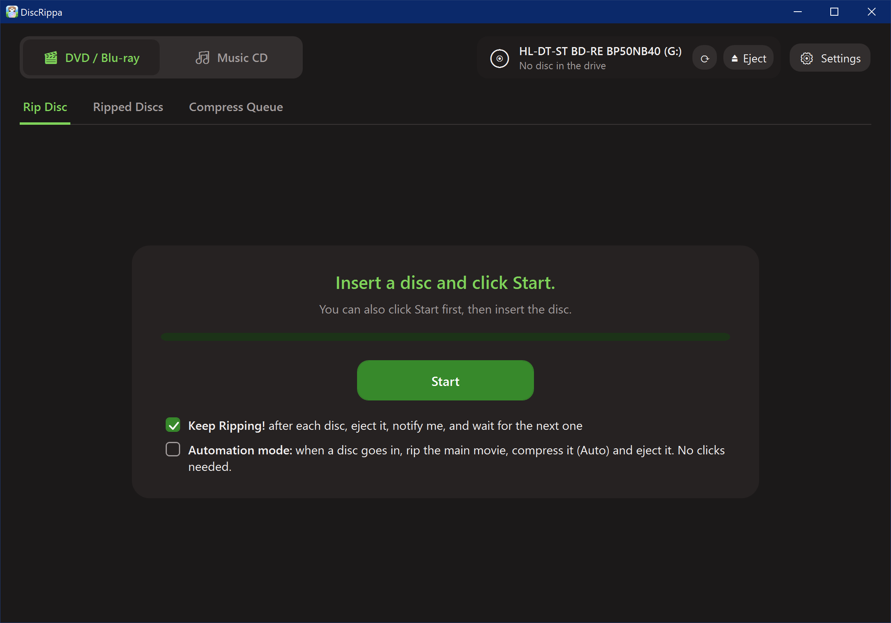
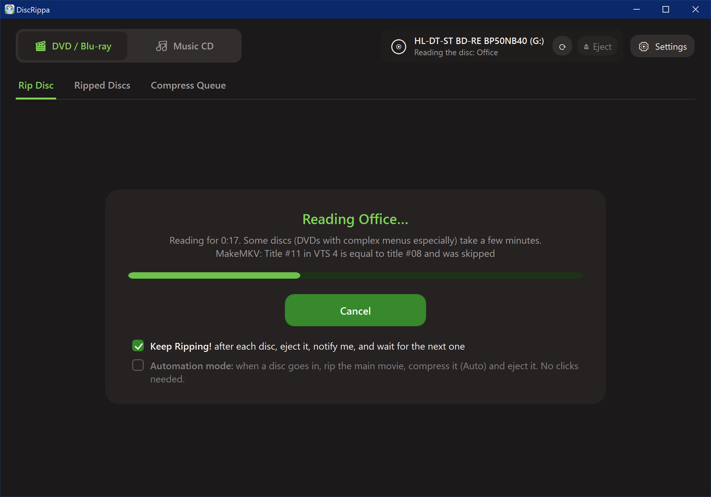
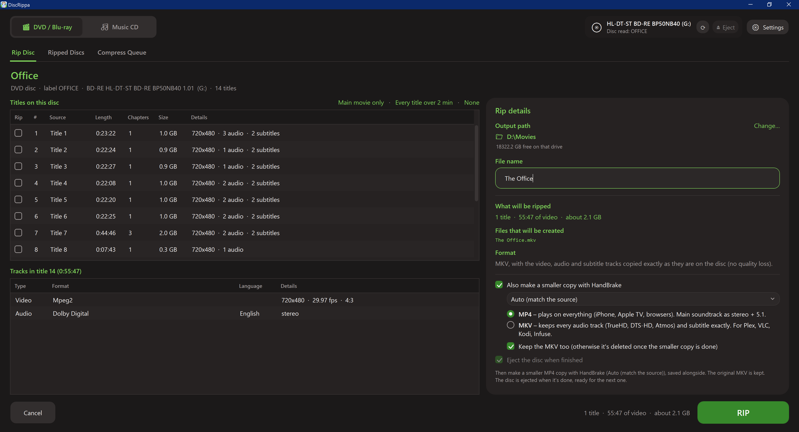
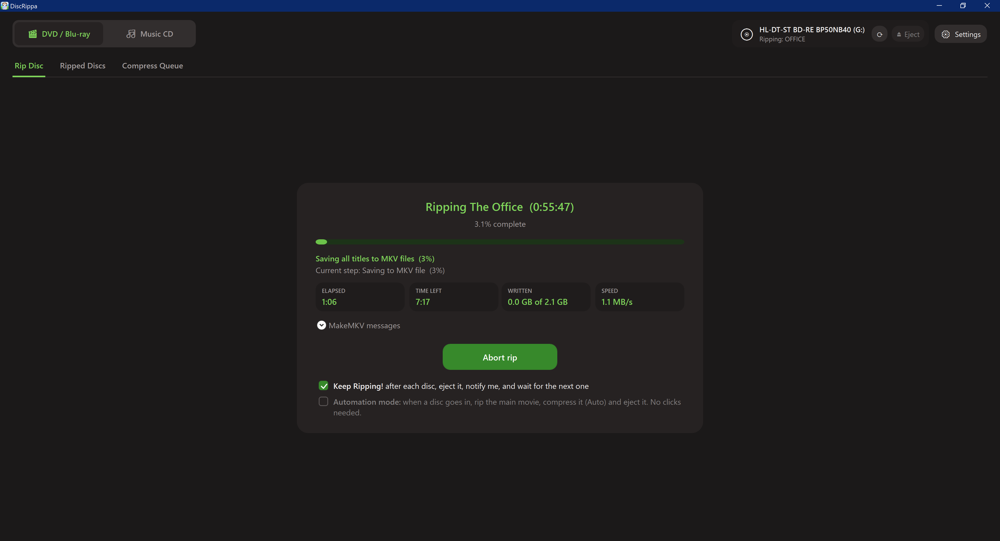
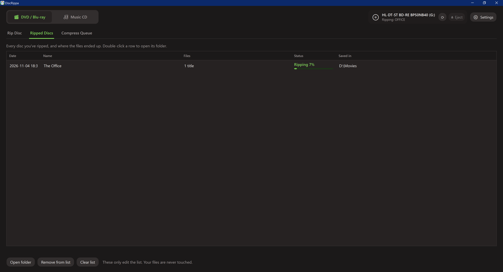
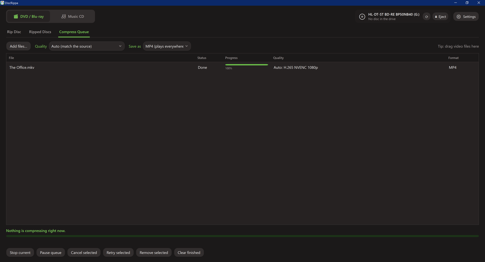
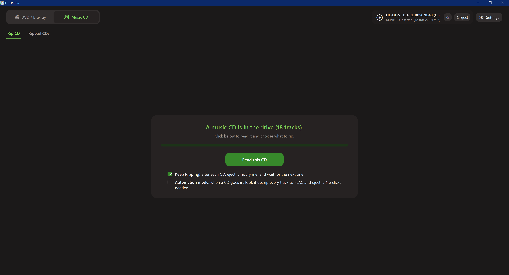
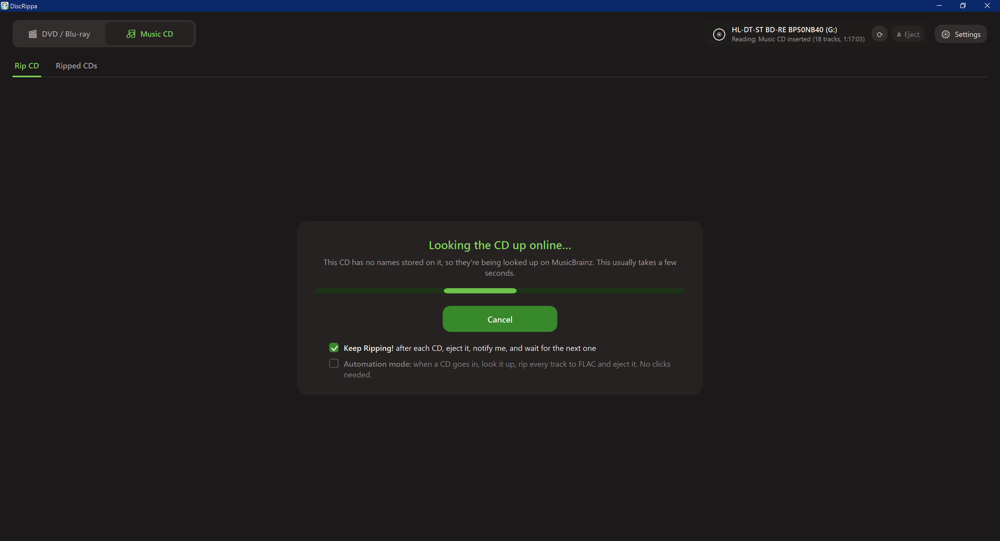
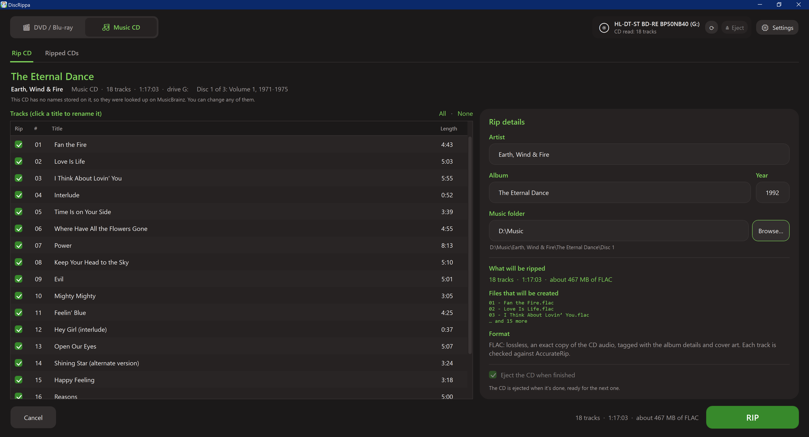

# DiscRippa     

DiscRippa is a simple Windows app for ripping your own discs: **DVDs and Blu-rays**, movies and TV shows alike, to
MKV (with an optional smaller MP4 or MKV copy), and **music CDs** to lossless, tagged FLAC.
It provides an easy-to-use interface around [MakeMKV](https://www.makemkv.com/), [HandBrake](https://handbrake.fr/)
and [cyanrip](https://github.com/cyanreg/cyanrip), so you don't have to touch the command line.

## Features

- **Shows what's on a disc before you rip it**: every title with its length, chapters and size, plus its video,
  audio and subtitle tracks. The main movie is picked for you.
- **Rips TV shows**: tick every episode on a disc and rip them in one go. They're saved together in a folder of their
  own and numbered in order, like `Show - 01 (00800.mpls).mkv`.
- **Makes smaller copies**: optionally compresses each rip to MP4 (plays everywhere) or MKV (keeps every audio and
  subtitle track), using your graphics card when it can.
- **Rips music CDs** to FLAC, tagged with the artist, album and track names, in `Artist\Album` folders. Names are read
  from the CD, or looked up online if the CD doesn't have them.
- **Keep Ripping!**: ejects each disc when it's done, lets you know, and waits for the next one.
- **Automation mode**: insert a disc and walk away. The main movie (or every track of a CD) is ripped and the disc
  ejected, with no clicks.
- **Remembers what you've ripped** and where it went.
- **Light and dark themes** and Windows notifications.

## Download

The latest version is on the [Releases page](../../releases/latest). Download `DiscRippa-<version>.zip`, unzip it
anywhere and run `DiscRippa.exe`. Keep the `tools` folder next to it. There's nothing to install.

The first launch takes a few seconds. Windows may warn that it doesn't recognise the app; choose
**More info › Run anyway**.

#### What else do I need?

- Windows 10 (version 1809 or later) or Windows 11, 64-bit.
- A DVD, Blu-ray or CD drive.
- **[MakeMKV](https://www.makemkv.com/)**, for DVDs and Blu-rays. Install it normally and DiscRippa finds it.
  Blu-rays also need a MakeMKV key: **Settings › System › Blu-ray key** installs MakeMKV's free beta key for you in
  one click. Click it again if Blu-rays stop working, since that key is renewed every month or two.

Everything else DiscRippa needs comes with it.

## How it works

### Ripping a DVD or Blu-ray

Pick **DVD / Blu-ray** at the top, then:

**1. Insert a disc and click Start** (that's the screen at the top of this page). You can also click Start first, then insert the disc.

**2. Wait while the disc is read.** This usually takes under a minute; DVDs with complex menus can take a few.

**3. Choose what to rip.** Tick titles on the left, or use the shortcuts above the list: **Main movie only**, **Every
title over 2 min** or **None**. Click a title to see its audio and subtitle tracks underneath. On the right:

- **Output path** is where your rips go. **Change…** takes you to the setting.
- **File name** is the name of the file. Tick several titles, such as every episode of a TV disc, and it becomes a
  **folder name**: the episodes go in that folder, numbered in order.
- **Also make a smaller copy** adds the rip to the compress queue (see below) as MP4 or MKV.

Then click **RIP**.

**4. Watch it go.** You'll see how far along it is, the time left, how much has been written and the speed. **Abort
rip** stops it and removes the unfinished file.

When it's done, the disc is ejected (if you asked), and you get a notification. With **Keep Ripping!** ticked, just
put the next disc in.

#### Ripped Discs

Every disc you've ripped is listed here, with where its files went. Double-click a row to open its folder. Removing
entries only edits the list; your files are never touched.

#### Compress Queue

Smaller copies are made here, one file at a time. Rips you asked to compress are added automatically, and you can
drag any video file onto the list to add it too.

- **Quality**: **Auto** matches each file's resolution and uses your graphics card (NVIDIA, Intel or AMD) when it can.
- **Save as**: **MP4** plays on everything (phones, TVs, browsers). **MKV** keeps every audio track and subtitle exactly
  as they were (best for Plex, VLC, Kodi or Infuse).
- If you chose to, the original MKV is deleted once its smaller copy has safely finished.

### Ripping a music CD

Pick **Music CD** at the top, insert a CD, and click **Read this CD**.

Album and track names are read from the CD itself. If it doesn't have any, they're looked up on MusicBrainz, which
usually takes a few seconds.

Check the names (click any track title to rename it), untick tracks you don't want, and click **RIP**. Tracks are saved
as `Artist\Album\01 - Title.flac`, tagged and with a cue sheet; box sets get a folder for each disc. Each track is
saved as soon as it's ripped, so if you stop part-way, what's done is kept.

The **Ripped CDs** tab lists every CD you've ripped, the same way Ripped Discs does.

### Settings

Click **Settings** at the top right. It has four tabs:

- **System**: where rips and smaller copies are saved, where MakeMKV, HandBrake and cyanrip are (found automatically),
  the Blu-ray key, and debug mode.
- **Blu-ray / DVD**: what's ticked by default for each disc (graphics card, deleting originals, Keep Ripping!).
- **Music CD**: whether to look CDs up online.
- **Windows**: light or dark theme, and notifications.

**Debug mode** pretends to have a drive and discs, so you can try everything without a disc. It keeps its own lists,
separate from your real ones.

## License and disclaimer

DiscRippa is distributed under the [MIT license](LICENSE). MakeMKV, HandBrake and cyanrip are separate programs with
their own licenses; see [THIRD-PARTY-NOTICES.md](THIRD-PARTY-NOTICES.md).

#### Use this application responsibly
The maintainers of DiscRippa cannot be held liable for misuse of this application, as stated in the MIT license.  
We do not condone the use of this software to violate local laws, including laws on copy protection (such as the DMCA).  
Users are personally responsible for ensuring they use this software fairly and within legal boundaries.
